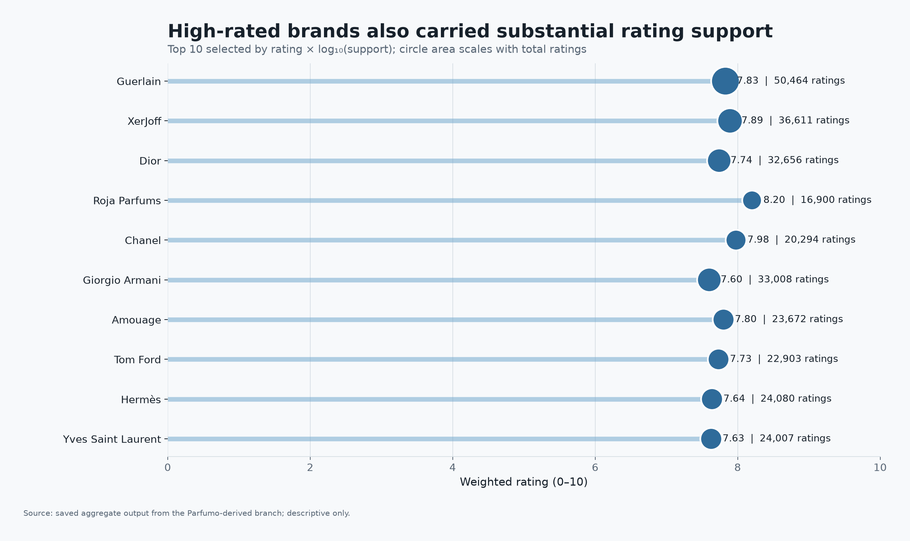
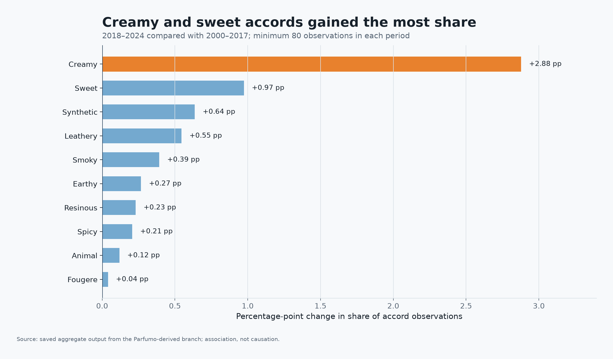
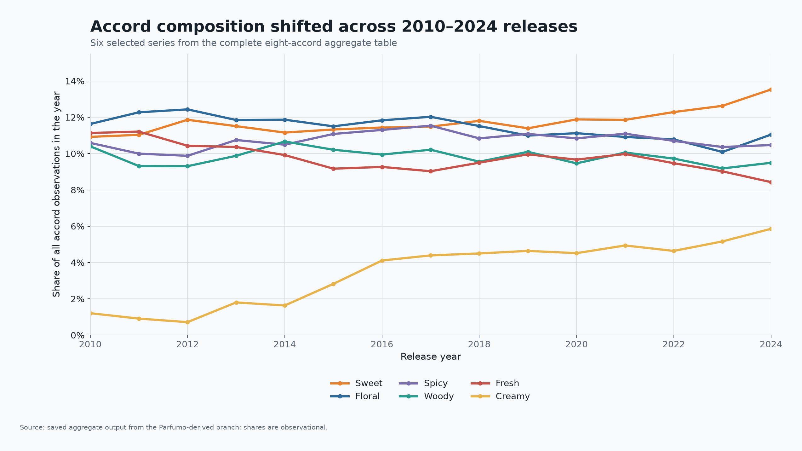
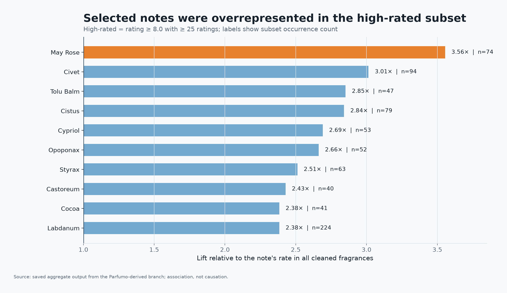

# Fragrance Data Lake: AWS and PySpark ETL

An individual data-engineering case study that uses Amazon S3 and Apache Spark
to turn large, heterogeneous fragrance datasets into curated tables and
decision-ready aggregate analyses.

The verified private execution parsed **23,911,390 Amazon review rows**, filtered
**57,428 fragrance products** from 1,028,914 metadata rows, and produced an
inner-joined table of **1,248,393 fragrance-review rows**. A separate
Parfumo-derived branch cleaned **30,046 fragrance records** and powered the
aggregate brand, accord, trend, and note analyses shown below.

[Pipeline source](src/spark_pipeline.py) · [Aggregate results](data/derived/) · [Methods and limitations](METHODS_AND_LIMITATIONS.md)



*Preview: a rebuilt chart from saved Parfumo-derived aggregate results. The Amazon review pipeline is a separate branch; the chart does not summarize the 23.9 million Amazon reviews.*

> This repository is a sanitized public reconstruction. It contains
> original code, aggregate result tables, and rebuilt charts—not raw data,
> credentials, cloud identifiers, execution logs, course materials, or the
> private submission.

<a id="what-this-project-demonstrates"></a>

## Skills demonstrated

| Skill | Evidence in this project |
| --- | --- |
| **Data engineering and ETL** | [PySpark pipeline](src/spark_pipeline.py) ingests JSON Lines/CSV, cleans schemas and text fields, filters records, deduplicates product keys and joins reviews to products. |
| **Python, Apache Spark and PySpark DataFrames** | DataFrame transformations, aggregations, term expansion and explicit numeric casting in the [pipeline source](src/spark_pipeline.py). |
| **AWS S3 and Parquet data lakes** | Runtime-supplied S3 or local paths, curated Parquet tables and separate analytics outputs; the workflow is EMR-oriented without publishing cloud identifiers. |
| **Spark execution configuration** | Broadcast review-to-product join, adaptive query execution and configurable shuffle partitions in [source](src/spark_pipeline.py); no benchmarked speedup is claimed. |
| **Data quality and reconciliation** | Required-column/range checks plus saved [row-count metrics](data/derived/pipeline_metrics.csv) and [result-contract tests](tests/test_derived_results.py). |
| **Data visualization and analytical communication** | [Matplotlib/Pandas renderer](src/create_visuals.py) turns compact aggregate tables into four descriptive charts with explicit denominators and support thresholds. |

## Pipeline

```text
Raw JSONL/CSV in S3 or local storage
             |
             v
PySpark parsing, validation, filtering, and deduplication
             |
             +--> Amazon fragrance products --> review join --> Parquet
             |
             +--> Parfumo cleanup --> aggregate brand/accord/note tables
                                                  |
                                                  v
                                      CSV results and visual checks
```

## Verified execution results

| Stage | Verified rows |
|---|---:|
| Amazon metadata parsed | 1,028,914 |
| Amazon fragrance products after filtering | 57,428 |
| Amazon reviews parsed | 23,911,390 |
| Amazon fragrance-review rows after inner join | 1,248,393 |
| Parfumo records after cleaning | 30,046 |
| Brand summary rows | 420 |
| Accord trend rows, 2010–2024 | 120 |
| High-rated note-lift rows | 127 |

These counts come from saved execution outputs that were reconciled against the
private analysis and report. The raw source files are not included here, so the
full 23.9-million-row run is not reproduced by this repository alone.

## Selected findings

### Strong brands combined high weighted ratings with broad support

The opening preview shows this result. The chart shows the ten brands selected by the private composite score
`weighted_rating * log10(total_rating_count)`. The x-axis remains on the full
0–10 rating scale, and support counts are shown separately to avoid equating a
small rating difference with a large practical effect.

### Creamy and sweet accords gained the most share in recent releases



Among terms meeting the minimum support thresholds, `creamy` increased by 2.88
percentage points and `sweet` by 0.97 points when comparing 2018–2024 with
2000–2017.

### Accord composition changed over time



The trend view reports shares of accord observations, not shares of unique
perfumes or consumer preferences. It is descriptive and does not establish a
cause for the changes.

### Some notes were overrepresented among the high-rated subset



Lift compares each note's rate in fragrances rated at least 8.0 with 25 or more
ratings against its rate in the full cleaned dataset. It is an association—not
evidence that a note causes higher ratings.

## Repository map

```text
assets/                 Rebuilt aggregate visualizations
data/derived/           Small aggregate tables used by the visuals and tests
src/spark_pipeline.py   Sanitized PySpark reconstruction
src/create_visuals.py   Deterministic visualization script
tests/                  Result-contract and safety checks
DATA_AND_USAGE.md       Provenance and redistribution boundaries
METHODS_AND_LIMITATIONS.md
```

## Reproduce the included visuals

```bash
python -m venv .venv
source .venv/bin/activate
python -m pip install -r requirements.txt
python src/create_visuals.py
pytest -q
```

## Run the Spark reconstruction

The script accepts local, S3, or other Spark-readable paths supplied by the
user. It does not download or redistribute any upstream data.

```bash
spark-submit src/spark_pipeline.py \
  --amazon-meta /path/to/amazon-metadata.jsonl \
  --amazon-reviews /path/to/amazon-reviews.jsonl \
  --parfumo /path/to/parfumo.csv \
  --output /path/to/output
```

Review [DATA_AND_USAGE.md](DATA_AND_USAGE.md) before acquiring or using any
source dataset. For exact formulas, thresholds, and interpretation boundaries,
see [METHODS_AND_LIMITATIONS.md](METHODS_AND_LIMITATIONS.md).

## Ownership and scope

Vansh Verma completed the analyzed pipeline, validation, and portfolio
reconstruction. Third-party datasets and marks remain the property of their
respective owners. The MIT license covers original code and documentation only.

